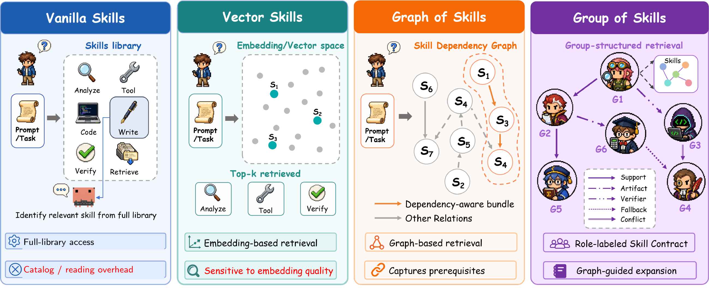
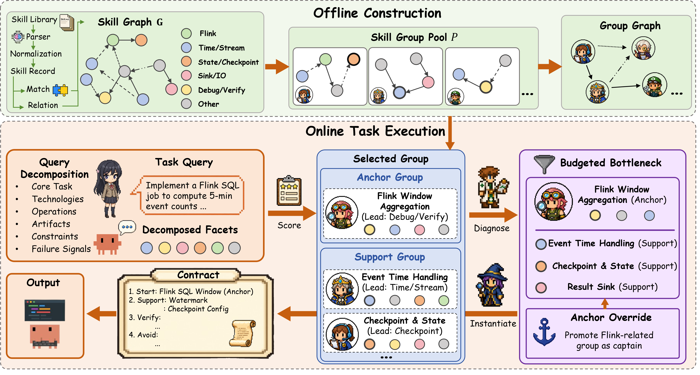

<h1 align="center">Group of Skills (GoSkills)</h1>

<p align="center">
  <strong>Group-Structured Skill Retrieval for Agent Skill Libraries</strong>
</p>

<p align="center">
  <a href="https://github.com/davidliuk/graph-of-skills"></a>
  <a href="https://huggingface.co/datasets/DLPenn/graph-of-skills-data"></a>
  <a href="https://www.python.org/downloads/"></a>
</p>

---

## Updates

- **[2026-05-07]** Released the GoSkills code package with SkillsBench generation helpers and an ALFWorld selector hook.
- **[2026-05-07]** Added GoS-compatible data download scripts for public skill libraries and SkillsBench tasks.

---

## Overview

GoSkills is an inference-time retrieval method for agent skill libraries. It builds on the public [Graph of Skills](https://github.com/davidliuk/graph-of-skills) benchmark/data stack, but changes the retrieval unit from a flat list of atomic skills to an anchor-centered **group plan**.

<p align="center">
  
</p>

Instead of flooding the agent context with a whole skill library or a loosely ranked top-k list, GoSkills returns a compact execution context with:

- an anchor skill group for the task core
- support, artifact, verifier, and fallback relations
- conflict pruning between incompatible groups
- a bounded set of presented `SKILL.md` payloads
- an execution contract with `Start`, `Support`, `Check`, `Avoid`, `Debt`, and `Skills`

The downstream agent, task environment, and skill payload format stay unchanged.

## How It Works

<p align="center">
  
</p>

**Retrieval pipeline:**

1. **Seed** -- retrieve lexical seed skills from the task query.
2. **Group** -- activate anchor-centered skill groups built offline from skill relations and shared artifacts.
3. **Expand** -- traverse the group graph over support, artifact, verifier, and fallback relations.
4. **Prune** -- remove conflicting or low-gain groups under a fixed group budget.
5. **Return** -- emit a capped, agent-readable execution contract and the selected skill payloads.

## Results

GoSkills is evaluated on **SkillsBench** and **ALFWorld**. **R** = average reward (%), **T** = input tokens, **S** = agent-only runtime (s). Higher reward is better; lower tokens and runtime are better.

| Model | Method | SB R↑ | SB T↓ | SB S↓ | AW R↑ | AW T↓ | AW S↓ |
|-------|--------|------:|------:|------:|------:|------:|------:|
| Gemini 3 Pro | Graph of Skills | 31.0 | 864,577 | 366.2 | 95.0 | 29,846 | 42.6 |
| | **GoSkills** | **38.6** | 881,492 | **327.9** | **97.9** | **27,215** | 49.2 |
| MiniMax M2.7 | Graph of Skills | 19.9 | **560,442** | 518.4 | 52.1 | 67,884 | 71.5 |
| | **GoSkills** | **24.3** | 867,452 | **402.5** | **54.3** | **65,227** | **68.8** |
| GPT-5.4 | Graph of Skills | 36.4 | **380,199** | 603.7 | 93.6 | **47,851** | 65.0 |
| | **GoSkills** | **48.9** | 694,825 | **352.9** | **95.3** | 63,319 | **38.2** |
| Claude Sonnet 4.5 | Graph of Skills | 38.7 | **421,884** | 571.9 | 94.6 | **49,120** | 62.7 |
| | **GoSkills** | **46.8** | 714,360 | **347.6** | **96.4** | 58,904 | **39.5** |
| Qwen 3.5 | Graph of Skills | 27.6 | **505,220** | 589.3 | 76.4 | **69,778** | 70.6 |
| | **GoSkills** | **33.5** | 756,930 | **421.7** | **80.7** | 74,502 | **55.3** |
| Kimi K2.5 | Graph of Skills | 33.8 | **455,906** | 545.1 | 90.7 | **54,336** | 63.1 |
| | **GoSkills** | **41.7** | 705,812 | **338.4** | **92.1** | 60,755 | **40.8** |

## Installation

### Requirements

- Python 3.10 -- 3.12
- `pip` or [`uv`](https://docs.astral.sh/uv/)
- Docker and Harbor for full SkillsBench runs
- an OpenAI-compatible chat endpoint for benchmark agents

### Setup

```bash
git clone <anonymous-repo-url>
cd Group-of-Skills
python -m venv .venv
. .venv/bin/activate
pip install -e ".[dev]"
cp .env.example .env
```

Fill `.env` with the API endpoint used by your benchmark agent:

```bash
OPENAI_API_KEY=<api-key>
OPENAI_BASE_URL=https://api.openai.com/v1
```

## Quick Start

Run the unit-level smoke tests:

```bash
pytest -q
```

Build and query a minimal GoSkills bundle:

```bash
python - <<'PY'
from goskills.group_graph import build_group_graph
from goskills.retrieval import retrieve

bundle = {
    "metadata": {"name": "minimal"},
    "skills": [
        {"name": "csv-cleaner", "description": "Clean and normalize CSV tables.", "inputs": ["csv"], "outputs": ["csv"]},
        {"name": "schema-verifier", "description": "Validate output schema and row counts.", "inputs": ["csv"], "outputs": ["test report"]},
        {"name": "xlsx-export", "description": "Export CSV tables to Excel workbooks.", "inputs": ["csv"], "outputs": ["xlsx"]},
    ],
    "edges": [
        {"source": "csv-cleaner", "target": "schema-verifier", "type": "workflow", "weight": 0.9}
    ],
}

bundle = build_group_graph(bundle)
result = retrieve(bundle, "clean csv data and verify output schema", top_n=4)
print(result["summary"])
PY
```

## CLI

The input bundle format is a JSON object with `metadata`, `skills`, and `edges`. The output bundle adds GoSkills group metadata under `group_graph`.

```bash
python -m goskills.cli build \
  --bundle path/to/source_bundle.json \
  --output path/to/goskills_bundle.json

python -m goskills.cli query \
  "recover xlsx cells and verify schema" \
  --bundle path/to/goskills_bundle.json \
  --top-n 4
```

After installation:

```bash
goskills-query "recover xlsx cells and verify schema" --bundle path/to/goskills_bundle.json
```

## Data

GoSkills reuses the public GoS data assets:

- skill libraries from [DLPenn/graph-of-skills-data](https://huggingface.co/datasets/DLPenn/graph-of-skills-data)
- SkillsBench tasks from [benchflow-ai/skillsbench](https://github.com/benchflow-ai/skillsbench)
- optional GoS-generated source bundles such as `graphskills_bundle.json`

Download assets with:

```bash
./scripts/download_data.sh --all
```

See [DATA.md](DATA.md) for download flags and expected directory layout.

## SkillsBench Evaluation

The SkillsBench path follows the GoS benchmark structure. Set `GRAPH_OF_SKILLS_ROOT` to a local checkout of the upstream GoS repository so GoSkills can reuse its task packaging and Harbor runtime utilities:

```bash
export GRAPH_OF_SKILLS_ROOT=/path/to/graph-of-skills
export OPENAI_API_KEY=<api-key>
export OPENAI_BASE_URL=https://api.openai.com/v1

./scripts/run_eval.sh
```

Useful overrides:

```bash
COMPARE_TASKS=task_a,task_b                 # run a subset
COMPARE_MODEL=gpt-5.4                       # model name passed to the API
COMPARE_REASONING_EFFORT=low                # reasoning effort when supported
COMPARE_GRAPH_ROOT=/path/to/graph-of-skills # same as GRAPH_OF_SKILLS_ROOT
COMPARE_GOSKILLS_ROOT=/path/to/this/repo    # GoSkills checkout
COMPARE_OUTPUT_ROOT=/path/to/generated      # generated task directory
COMPARE_DIRECT_BASE_URL=https://.../v1      # OpenAI-compatible endpoint
```

## ALFWorld Hook

The ALFWorld hook in `evaluation/alfworld/goskills_selector.py` maps a visible ALFWorld goal to a captain/support skill plan. It is dependency-free and can be called from an external ALFWorld runner.

```bash
pytest tests/test_alfworld_selector.py -q
```

Full ALFWorld execution requires the external ALFWorld simulator and task assets.

## Repository Layout

```text
Group-of-Skills/
├── goskills/                    # Core GoSkills implementation
│   ├── group_graph.py           # Offline anchor-group and retrieval graph construction
│   ├── retrieval.py             # Query-time group activation, expansion, pruning, rendering
│   ├── text.py                  # Tokenization, weighting, query decomposition
│   └── cli.py                   # Build/query CLI
├── gos/core/parsing.py          # Minimal SKILL.md parser for benchmark builders
├── data/                        # Downloaded data; gitignored
├── evaluation/
│   ├── alfworld/                # ALFWorld selector hook
│   └── skillsbench/             # SkillsBench generation and direct-API runner
├── skills/goskills-retriever/   # Container bootstrap skill
├── scripts/                     # Data download, benchmark, and release-check scripts
├── tests/                       # Smoke tests
├── assets/                      # README figures
├── DATA.md                      # Data and download guide
└── pyproject.toml               # Package definition
```

## Documentation

| Document | What it covers |
|----------|----------------|
| [DATA.md](DATA.md) | Downloading GoS skill libraries and SkillsBench task assets |
| [evaluation/alfworld/README.md](evaluation/alfworld/README.md) | ALFWorld selector interface |
