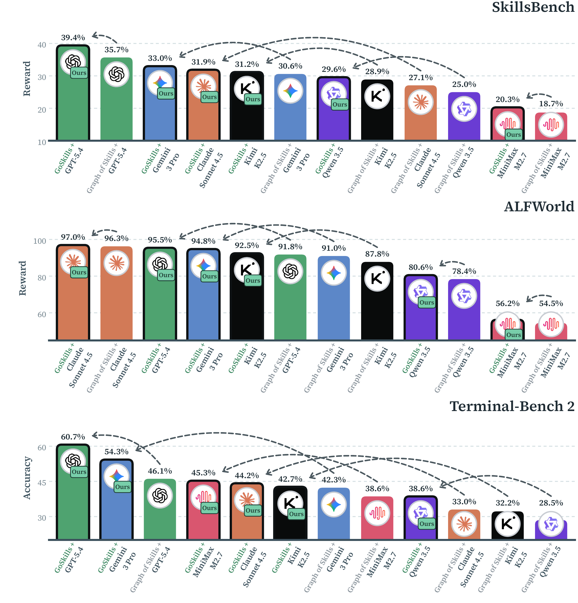

<h1 align="center">[NeurIPS '26] Group of Skills (GoSkills)</h1>

<p align="center">
  <strong>Group-Structured Skill Retrieval for Agent Skill Libraries</strong>
</p>

<p align="center">
  <strong>Kun Zeng</strong><sup>*</sup> &middot;
  <a href="https://github.com/yuhuo03"><strong>Yu Huo</strong></a><sup>*</sup> &middot;
  <strong>Siyu Zhang</strong> &middot;
  <strong>Zi Ye</strong> &middot;
  <strong>Yuecheng Zhuo</strong> &middot;
  <strong>Haoyue Liu</strong> &middot;
  <strong>Yuquan Lu</strong> &middot;
  <strong>Junhao Wen</strong> &middot;
  <strong>Xiaoying Tang</strong><sup>†</sup>
</p>

<p align="center">
  <a href="https://openreview.net/forum?id=MmJBYf16Bn"></a>
  <a href="https://openreview.net/forum?id=MmJBYf16Bn"></a>
  <a href="https://huggingface.co/datasets/yuhuo03/group-of-skills-data"></a>
  <a href="LICENSE"></a>
  <a href="https://www.python.org/downloads/"></a>
</p>

---

## 🔥 Updates

- **[2026-11-07]** Skill libraries and prebuilt workspaces at **200, 500, 1,000 and 2,000 skills** released on [HuggingFace](https://huggingface.co/datasets/yuhuo03/group-of-skills-data).
- **[2026-09-24]** 🎉 **Group of Skills is accepted to NeurIPS 2026 (Poster)!**
- **[2026-05-06]** Code open-sourced on [GitHub](https://github.com/yuhuo03/Group-of-Skills).

---

## Overview

GoSkills builds **anchor-centered skill groups** offline from a typed skill graph,
then retrieves a compact **group plan** at task time. The plan combines the task's
anchor skill with relevant support and checking skills, prunes incompatible
choices, and presents bounded source instructions to the agent. GoSkills builds
on the [Graph of Skills](https://github.com/davidliuk/graph-of-skills) data and
benchmark stack.

<p align="center">
  
</p>

## How It Works

<p align="center">
  
</p>

**Retrieval pipeline:**

1. **Seed** -- retrieve lexical candidate skills for the visible task query.
2. **Group** -- activate reusable anchor-centered groups and their supporting relations.
3. **Prune** -- remove incompatible or low-gain choices under group and context budgets.
4. **Return** -- emit a bounded execution contract and source-preserving skill payloads.

The returned plan identifies where to start, which support and checking skills to
use, and visible requirement cues not covered by the presented skill text. See
[the method guide](goskills/README.md) for the graph schema and retrieval settings.

## Citation

If you find this work useful, please cite:

```bibtex
@software{zeng2026goskills,
  title   = {Group of Skills: Group-Structured Skill Retrieval for Agent Skill Libraries},
  author  = {Zeng, Kun and Huo, Yu and Zhang, Siyu and Ye, Zi and Zhuo, Yuecheng and
             Liu, Haoyue and Lu, Yuquan and Wen, Junhao and Tang, Xiaoying},
  year    = {2026},
  version = {0.2.0rc2},
  url     = {https://github.com/yuhuo03/Group-of-Skills}
}
```

<sup>*</sup> Equal contribution. <sup>†</sup> Corresponding author.

## Installation

### Requirements

- Python 3.10 -- 3.12 for core retrieval (Python 3.12 recommended)
- Git
- [`uv`](https://docs.astral.sh/uv/) for virtual environments; `pip` for package installation
- Linux, Python 3.12, Docker Engine and Docker Compose v2 for full benchmark runs
- An OpenAI-compatible API key for benchmark agents and embedding-backed baselines

### Setup

```bash
git clone https://github.com/yuhuo03/Group-of-Skills.git
cd Group-of-Skills
uv venv --python 3.12 --seed .venv
. .venv/bin/activate
python -m pip install -e ".[dev]"
python -m pip check
```

Core build/query needs no API key. For benchmark runs, configure the shell
variables below and follow [the evaluation setup](evaluation/README.md#setup) to install
the separate terminal and retrieval environments.

To use a local configuration file:

```bash
cp .env.example .env
# Edit .env: set your API key and a graph-construction model.
set -a
. ./.env
set +a
```

`GOS_LLM_MODEL` selects the upstream graph-construction model. GoSkills group
construction and retrieval do not require a language model.

<details>
<summary><strong>Provider: OpenAI (direct)</strong></summary>

```bash
export OPENAI_API_KEY="YOUR_API_KEY"
unset OPENAI_BASE_URL
export GOS_EMBEDDING_MODEL=openai/text-embedding-3-small
export GOS_EMBEDDING_DIM=1536
```

These are shell variables. The launchers do not automatically load `.env`.
GoSkills retrieval uses lexical seeds and makes no embedding calls.

</details>

<details>
<summary><strong>Provider: OpenAI-compatible endpoint</strong></summary>

```bash
export OPENAI_API_KEY="YOUR_API_KEY"
export OPENAI_BASE_URL=https://YOUR-ENDPOINT/v1
export GOS_EMBEDDING_MODEL=openai/text-embedding-3-small
export GOS_EMBEDDING_DIM=1536
```

The endpoint must support the configured chat model and, for Vector / Graph of
Skills, the same embedding model used to construct the workspace.

</details>

## Quick Start

### Step 1: Download skill libraries and prebuilt workspaces

After [Installation](#installation), download the **200, 500, 1,000 and 2,000-skill**
libraries and matching GoSkills workspaces from
[Hugging Face](https://huggingface.co/datasets/yuhuo03/group-of-skills-data):

```bash
python scripts/download_data.py --sizes 200 500 1000 2000
```

Or choose one size instead:

```bash
python scripts/download_data.py --sizes 200
```

The script downloads both the library and workspace for each selected size,
verifies their checksums, and extracts them into `data/external/`. It makes no
model API calls. Use `--dry-run` to preview, `--assets skills` or
`--assets workspaces` to download only one asset type, and `--output PATH` to
choose another destination. Existing directories are preserved; reuse completed
downloads instead of running the same command again.

| Size | Skill library | GoSkills pool |
|------|---------------|---------------|
| 200 | `data/external/skills_200/` | `data/external/goskills_workspace_skills_200_v1/pool.json` |
| 500 | `data/external/skills_500/` | `data/external/goskills_workspace_skills_500_v1/pool.json` |
| 1,000 | `data/external/skills_1000/` | `data/external/goskills_workspace_skills_1000_v1/pool.json` |
| 2,000 | `data/external/skills_2000/` | `data/external/goskills_workspace_skills_2000_v1/compiled-pool/` |

Each workspace also contains its graph and vector index in `graph_workspace/`.
Always pair a workspace with the skill library of the same size.

### Step 2: Retrieve

Query the downloaded 200-skill pool locally:

```bash
QUERY_DIR=$(mktemp -d)
python -m goskills query \
  --pool data/external/goskills_workspace_skills_200_v1/pool.json \
  --source-root data/external/skills_200 \
  --query "Convert a CSV table to JSON and validate the output schema." \
  --output-json "$QUERY_DIR/answer.json"
python -m goskills validate-bundle "$QUERY_DIR/answer.json"
```

For 500 or 1,000 skills, replace `200` in both paths. The 2,000-skill workspace
uses a compiled pool; query it with:

```bash
python -m goskills_eval.retrieval \
  --pool data/external/goskills_workspace_skills_2000_v1/compiled-pool \
  --source-root data/external/skills_2000 \
  --query "Convert a CSV table to JSON and validate the output schema."
```

Both commands return a bounded execution contract without calling an API.
The saved JSON bundle contains selected groups, skill payloads, source spans,
selection traces, and coverage debt. Use a fresh output path for each saved query.

### Step 3: Extend or evaluate

- **Build a custom workspace:** [DATA.md](DATA.md#3-build-a-directed-index-and-goskills-group-pool) documents graph indexing, export, and local group construction.
- **Integrate an agent:** see [Agent Integration](#agent-integration) for the Python and CLI interfaces.
- **Run benchmarks:** follow [evaluation/README.md](evaluation/README.md) to prepare benchmark inputs and the five evaluation methods. Downloading skill data does not launch an experiment.

## Agent Integration

### Agent skills

The `skills/` directory provides three agent-facing retrieval skills:

| Skill | Retrieval method |
|-------|------------------|
| [goskills-retriever](skills/goskills-retriever/SKILL.md) | GoSkills group plans from a prepared pool; no embedding API |
| [graph-skills-retriever](skills/graph-skills-retriever/SKILL.md) | Graph of Skills retrieval from a prepared graph workspace |
| [vector-skills-retriever](skills/vector-skills-retriever/SKILL.md) | Vector similarity retrieval from a prepared workspace |

Copy the desired folder into your agent's skill directory. To install all three
for Codex, run from the repository root:

```bash
mkdir -p ~/.codex/skills
cp -R skills/goskills-retriever skills/graph-skills-retriever \
  skills/vector-skills-retriever ~/.codex/skills/
```

For Claude Code, use `~/.claude/skills/` instead. Supply the installed Python
interpreter and matching local asset paths. GoSkills needs its pool and source
library; Graph and Vector also need the pinned upstream checkout, workspace,
and configured embedding provider from [DATA.md](DATA.md). In Codex, invoke
`$goskills-retriever`, `$graph-skills-retriever`, or `$vector-skills-retriever`.
These folders contain retrieval instructions, not the experimental skill library.
No Skills uses no library; Vanilla exposes the library directly, so neither
needs a retrieval skill. All five evaluation methods remain available.

### Python / CLI

An agent can call the retrieval CLI or use the same core through Python:

```python
from goskills.config import validate_config
from goskills.groups import build_pool
from goskills.io import read_json
from goskills.retrieval import Retriever
from goskills.validation import validate_bundle

pool = build_pool(read_json("data/external/native-graph.json"), validate_config())
bundle = Retriever(pool).query("Parse STL and produce JSON with unit tests.")
validate_bundle(bundle)
print(bundle["rendered_context"])
```

**Available interfaces:**

| Interface | Purpose |
|-----------|---------|
| `build_pool` | Construct reusable groups from a typed graph |
| `Retriever.query` | Retrieve an execution contract and source skill payloads |
| `validate_bundle` | Verify rendered context, budgets, and coverage debt |
| `python -m goskills` | Use the build/query/validate workflow from the shell |

### Docker / Container (SkillsBench)

The SkillsBench adapter exposes an agent-facing retrieval command inside the
benchmark interaction:

```bash
goskills-query "parse binary STL file and calculate mass"
```

The bash adapter dispatches this query to the host retriever and returns the
bounded contract. Source paths refer to the skill library mounted at
`/opt/graphskills/skills`. The other retrieval conditions use `vectorskills-query`
and `graphskills-query`. See [SkillsBench evaluation](evaluation/skillsbench/README.md)
for task preparation and container integration.

## CLI Reference

| Command | Description |
|---------|-------------|
| `goskills export-native` | Export the pinned compatible GoS workspace as a typed source graph |
| `goskills build` | Build a reusable group pool from a source graph |
| `goskills query` | Retrieve a bounded skill bundle and execution contract |
| `goskills validate-bundle` | Validate bundle integrity, context budgets, and coverage debt |
| `goskills-query` | Agent-facing retrieval inside the SkillsBench bash adapter |
| `python scripts/download_data.py` | Download skill libraries and matching workspaces from Hugging Face |
| `.venv-eval/bin/python scripts/run_benchmark.py` | Plan or execute benchmark/method combinations |
| `.venv-eval/bin/python scripts/summarize_runs.py` | Aggregate per-trial scores, tokens, and runtime |

## Configuration

Provider variables are documented in [`.env.example`](.env.example). Evaluation
asset paths are set in [evaluation/experiments/configs/local.example.json](evaluation/experiments/configs/local.example.json).
GoSkills uses the following default settings:

| Setting | Default | Description |
|---------|---------|-------------|
| `seed_mode` | `lexical` | Query-visible lexical seeding |
| `seed_top_k` | `4` | Initial candidate skills |
| `top_n` | `4` | Maximum presented skills |
| `max_context_chars` | `9000` | Full rendered-context character cap |
| Skill body cap | `1800` | Maximum characters per source skill |
| Members per group | `3` | Offline group-size cap |
| Selected groups | `3` | Online group-selection cap |

See [Method](goskills/README.md) for exact policy fields and validation rules.

> **Note:** Vector and Graph of Skills must use the same embedding model and
> dimension at retrieval time as at index construction.

## Results

<p align="center">
  <a href="assets/benchmark_rewards.pdf">
    
  </a>
</p>

<p align="center"><a href="assets/benchmark_rewards.pdf">Download figure (PDF)</a></p>

## Evaluation

**Docs:** Start with [evaluation/README.md](evaluation/README.md) for the five
methods and benchmark entrypoints. The complete environment setup is in
[the evaluation setup guide](evaluation/README.md#setup); task and index preparation
are in [DATA.md](DATA.md).

The runners support three benchmarks:

| Benchmark | Type |
|-----------|------|
| **ALFWorld** | Interactive household tasks |
| **SkillsBench** | Dockerized coding tasks |
| **Terminal-Bench 2** | Dockerized terminal tasks |

All support `noskills`, `vanilla`, `vector`, `native-gos`, and `goskills-d`.
After preparing the inputs, configure and run the shared launcher:

```bash
cp evaluation/experiments/configs/local.example.json evaluation/experiments/configs/local.json
.venv-eval/bin/python scripts/doctor.py --config evaluation/experiments/configs/local.json --runtime

# Plan all 15 combinations without calling a provider.
.venv-eval/bin/python scripts/run_benchmark.py --config evaluation/experiments/configs/local.json \
  --benchmark all --methods all --output runs/gpt54-all

# Execute the plan as a new run (billable API calls and benchmark environments).
.venv-eval/bin/python scripts/run_benchmark.py --config evaluation/experiments/configs/local.json \
  --benchmark all --methods all --output runs/gpt54-all --execute

.venv-eval/bin/python scripts/summarize_runs.py runs/gpt54-all --output outputs/gpt54-all-table
```

Use a fresh output directory for each run. The launcher preserves completed
records and stops dispatch on infrastructure or incomplete-verifier failures.
A valid zero score remains zero; missing results remain missing.

<details>
<summary><strong>Minimal Verification (end-to-end smoke test)</strong></summary>

**Scope:** one GoSkills task on Terminal-Bench 2. This is a setup check, not a full
benchmark sweep. The commands below invoke APIs only when `--execute` is added.

**Prerequisites:**

- Both Python environments and the original datasets from [DATA.md](DATA.md).
- A compatible full-library workspace and GoSkills group pool.
- Docker running and `OPENAI_API_KEY` exported in the shell.
- `evaluation/experiments/configs/local.json` populated with the local asset paths.

**1. Validate local inputs**

```bash
.venv-eval/bin/python scripts/doctor.py --config evaluation/experiments/configs/local.json --runtime
```

**2. Preview one task**

```bash
.venv-eval/bin/python scripts/run_benchmark.py --config evaluation/experiments/configs/local.json \
  --benchmark tb2 --methods goskills-d --tasks adaptive-rejection-sampler \
  --output runs/tb2-one
```

**3. Run and summarize the task**

```bash
.venv-eval/bin/python scripts/run_benchmark.py --config evaluation/experiments/configs/local.json \
  --benchmark tb2 --methods goskills-d --tasks adaptive-rejection-sampler \
  --output runs/tb2-one --execute
.venv-eval/bin/python scripts/summarize_runs.py runs/tb2-one --output outputs/tb2-one
```

**4. What "success" looks like**

- The run produces `PLAN.json`, `STATUS.json`, and a per-trial result receipt.
- The summary reports one completed trial and its score, token usage, and runtime.
- A complete verifier result may legitimately score zero. A transport or
  environment failure is recorded separately and is not converted to zero.

</details>

## Repository Layout

```
Group-of-Skills/
├── assets/                      # Method figures
├── evaluation/                  # Three benchmarks and five methods
│   ├── alfworld_run.py          #   ALFWorld entrypoint
│   ├── skill.py                 #   Shared five-method skill interface
│   ├── alfworld/                #   ALFWorld adapters and requirements
│   ├── skillsbench/             #   SkillsBench entrypoint, agents and requirements
│   ├── terminalbench2/          #   TB2 entrypoint and configuration
│   ├── experiments/             #   Batch runner and task/configuration manifests
│   └── analysis/                #   Score, token and runtime summaries
├── goskills/                    # Group construction, retrieval and CLI
├── scripts/                     # Asset preparation and evaluation utilities
├── skills/                      # Agent-facing group, graph and vector retrieval skills
├── tests/                       # Offline tests
├── .env.example                 # Provider configuration template
├── pyproject.toml               # Package definition
├── CONTRIBUTING.md              # Development guide
└── DATA.md                      # External data and workspace setup
```

## Documentation

| Document | What it covers |
|----------|----------------|
| [DATA.md](DATA.md) | Skill library, benchmark inputs and workspace preparation |
| [goskills/README.md](goskills/README.md) | Group construction, retrieval and graph schema |
| [skills/goskills-retriever/SKILL.md](skills/goskills-retriever/SKILL.md) | Agent instructions for GoSkills retrieval |
| [evaluation/README.md](evaluation/README.md) | Three benchmarks and five methods |
| [evaluation/skillsbench/README.md](evaluation/skillsbench/README.md) | SkillsBench |
| [evaluation/alfworld/README.md](evaluation/alfworld/README.md) | ALFWorld |
| [evaluation/terminalbench2/README.md](evaluation/terminalbench2/README.md) | Terminal-Bench 2 |
| [CONTRIBUTING.md](CONTRIBUTING.md) | Development setup and tests |

## License

GoSkills is released under the [MIT License](LICENSE). Third-party components and
datasets retain their own licenses; see [DATA.md](DATA.md#attribution).
